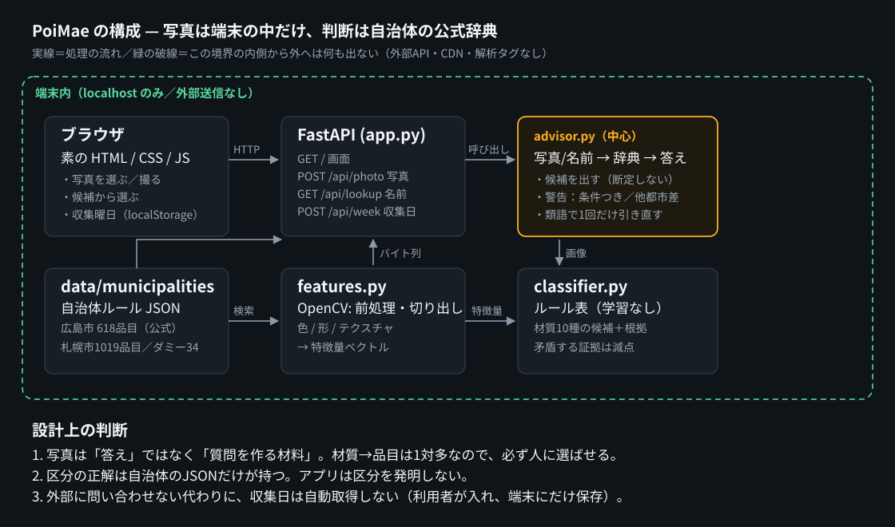

# 構成 — PoiMae



構成図は [`architecture.svg`](architecture.svg)（ブラウザで開けます）。
緑の破線が**プライバシー境界**で、この内側から外へ出る通信はありません。

## 1. 全体の流れ

```
[ブラウザ]                    [FastAPI/127.0.0.1]            [ローカルのファイル]
写真を選ぶ  ──multipart──▶  /api/photo
                              │
                              ├─ features.analyze()      OpenCV で特徴量
                              ├─ classifier.classify()   材質の候補＋根拠
                              ├─ 類語で辞典を引く         municipalities.json
                              └─ advisor.build_answer()  候補・警告・他都市差分
                                    │
                                    ▼
                               JSON で返す ──▶ 画面に候補を出す ──▶ 人が選ぶ
```

名前で引く場合（`/api/lookup`）は特徴量を経由しません。同じ `advisor` を通ります。

## 2. モジュールと責務

| ファイル | 行数目安 | 責務 | 依存 |
| --- | --- | --- | --- |
| `src/poimae/normalize.py` | 78 | 検索語の正規化（ひらがな化・全角半角・括弧除去・バイグラム） | 標準ライブラリのみ |
| `src/poimae/features.py` | 236 | 画像 → 特徴量（物体の切り出し、色・形・テクスチャ） | OpenCV, numpy |
| `src/poimae/classifier.py` | 243 | 特徴量 → 材質の候補（ルール表・根拠・減点） | なし（純粋関数） |
| `src/poimae/municipalities.py` | 310 | 自治体JSONの読み込み・検索（4段階の一致） | 標準ライブラリ |
| `src/poimae/advisor.py` | 240 | 写真/名前 → 辞典 → 答えの組み立て | 上記すべて |
| `src/poimae/crosscity.py` | 156 | 自治体間の差分（同じ品目で区分が違うもの） | municipalities |
| `src/poimae/calendar.py` | 119 | 「今週のごみの日」 | 標準ライブラリ |
| `src/poimae/app.py` | 162 | HTTP の入口（8エンドポイント） | FastAPI |

**依存の向きは一方向**です。`app → advisor → {features, classifier, municipalities}`。
`municipalities` と `classifier` は FastAPI を知りません（テストが直接呼べます）。

## 3. 写真 → 材質（features.py）

写真から「材質」を出すまでに、2つの落とし穴がありました。どちらも実装中に実測で見つけて直しています。

### 3.1 背景ではなく、物体を測る

最初は画像全体の色とテクスチャを測っていました。ところが白い机の上で撮った写真では、
**背景の白が全物体を「白くてつやのある物体」に見せて**しまい、分類が崩れました。

そこで `_segment()` を入れました。

1. グレースケール → Otsu の二値化
2. **画像の外周（境界）の画素がどちら側に多いかで前景/背景を決め、必要ならマスクを反転**
3. 最大の輪郭を塗りつぶして物体マスクとする
4. 物体が小さすぎる（面積比 < `MIN_OBJECT_RATIO` = 1.5%）ときは `object_found=False` とし、
   全面の統計で代用したうえで**その旨を応答に注記**する

色・テクスチャ・エッジ・ハイライト率は**すべて物体マスクの内側だけ**で計算します。
アスペクト比も物体のバウンディングボックスから取ります。

> 2 の極性判定は、実装当初のバグの修正でもあります。白背景の写真で「背景」を物体と
> 誤認し、`solidity` や `extent` が常に 1.0 になっていました。
> `tests/test_features.py::test_foreground_is_the_object_not_the_frame` が回帰テストです。

### 3.2 「つや」は、明るさではなくハイライトで見る

「白くて明るい = つやがある」と定義すると、**白い紙が 90% つやあり**と判定されて
紙と陶器が区別できなくなります。そこで `specular_ratio` を

> 物体の輝度の中央値 + 0.08（上限 0.97）以上、かつ彩度 0.20 以下の画素の割合

と定義し直しました。物体の中の**相対的に明るい点**を数えるので、白い物体でも
「のっぺりしている（ハイライトが無い）」と「てかっている」を分けられます。

## 4. 材質の候補（classifier.py）

**学習モデルではありません。** 特徴量に対するルール表です。

- 10クラス: `pet_bottle, metal_can, glass_bottle, paper, cardboard, plastic_film,
  food_waste, battery, textile, ceramic`（+ `unknown`）
- 各クラスは (理由文, 述語, 重み) の並び。**正の重み**は「その材質らしい証拠」、
  **負の重み**は「その材質らしくない証拠」です。
- スコアは `max(0, 獲得点 / 正の重みの合計)`。**0.34 未満なら `unknown` を先頭に置きます。**
- 返すのは `Evidence(material, label_ja, score, reasons, contradictions)` の並び（既定 top 4）。
- `candidate_keywords()` が材質名を**日本語の検索語**に変換します
  （例: `pet_bottle` → 「ペットボトル」）。ここで初めて自治体の辞典と接続します。

### 減点（矛盾証拠）を入れた理由

素点だけだと、**平坦な灰色のカードが「陶器」「紙」「プラ袋」の3つで同時に 1.00** になり、
「3つの別解が同点で高信頼」という、いちばん困る表示になっていました。
`強いつや（陶器らしくない） -1.2` のような負の証拠を入れると、この3つは揃って下がり、
`unknown` が先頭に出ます。**「分からない」と言えることが、この分類器の機能**です。

### 閾値の出处

ルール表の閾値は、**開発用の合成画像60枚**（`eval/synthetic` の `split=dev`）の
中央値から決めています。評価用60枚（`split=test`）は閾値を決めるのに使っていません。
この分離は `classifier.py` の docstring と `docs/EVALUATION.md` に明記しています。

## 5. 自治体ルール（municipalities.py）

JSON 1ファイル = 1自治体。差し替え可能です。

```json
{
  "id": "hiroshima",
  "display_name": "広島市",
  "verified": true,
  "data_kind": "official",
  "source": {"url": "...", "title": "...", "retrieved_at": "2026-10-20", "file": "...", "sha256": "..."},
  "categories": [{"label": "可燃ごみ", "generic": "burnable", "default_fee": null}],
  "items": [{"name": "乾電池", "category": "有害ごみ", "generic": "hazardous", "note": "..."}]
}
```

- **`generic`** は自治体をまたいだ比較用の語彙（`burnable`, `non_burnable`,
  `plastic_packaging`, `hazardous`, `oversized`, `not_collected`, `other`, `null`）。
  表示は `label`（自治体の言葉）、比較は `generic`（共通語）で行います。
- 検索は4段階: `exact`（1.0）→ `prefix`（0.95）→ `contains`（長さ比で減衰）→
  `fuzzy`（Dice 係数または LCS 比に**長さ比を掛けた**もの、下限 `FUZZY_FLOOR`=0.42）。
  長さ比を掛けるのは、短い辞書語が長い検索語に含まれるだけで高得点になるのを防ぐため
  （`かんでんち` に対して `やかん` が 0.857 になっていた）。
- `lookup()` の `confident` は「完全一致」または「前方一致かつ3文字以上」のみ true。
  同点で別の区分があれば false にします。
- 類語表（7組）で**1回だけ**引き直します。引き直したときは応答に
  `matched_via: "synonym"` と元の語を残し、**画面にもその旨を表示**します。

## 6. 答えの組み立て（advisor.py）

`build_answer()` が返す JSON の骨格:

| キー | 中身 |
| --- | --- |
| `municipality` / `verified` / `data_kind` | どの自治体の、公式か、ダミーか |
| `lookup` | 一致の種類・確信度・候補（品目名・区分・手数料・注記） |
| `question` | 人が選ぶための問い（候補が1件か複数かで文言を変える） |
| `warnings` | `conditional`（条件つき注記）/ `cross_city`（他都市と違う）/ `unverified_source` / `synonym` |
| `other_cities` | 同じ品目が他の自治体で何区か |
| `features` / `material_evidence` / `keywords` | 写真のときだけ。特徴量・材質候補・検索語 |

**写真からの候補は `exact` と `prefix` だけ**に絞っています。あいまい一致まで通すと、
「かん」から「やかん」のような無関係な候補が混ざるためです（意図的な設計）。

## 7. HTTP（app.py）

| メソッド | パス | 用途 |
| --- | --- | --- |
| GET | `/` | 画面（`static/index.html`） |
| GET | `/api/health` | 起動確認。`network: "disabled - this app makes no outbound requests"` を返す |
| GET | `/api/municipalities` | 自治体の一覧（バッジ用の `verified` / `data_kind` 付き） |
| GET | `/api/municipalities/{id}` | 区分の一覧と品目数 |
| GET | `/api/lookup?municipality=&q=` | 名前で引く |
| POST | `/api/photo?municipality=` | 写真で引く（multipart、上限あり） |
| POST | `/api/week` | 今週のごみの日を計算（保存はしない） |
| GET | `/api/ambiguity` | 都市間で割れている品目の一覧（解説用） |

アップロードは MIME とサイズを検査し、`415` / `413` / `400` を返します。
**画像はメモリ上で処理して破棄**し、ディスクにもログにも残しません。

## 8. 画面（static/）

- 素の HTML/CSS/JS。**CDN・webfont・解析タグを読みません**（`tests/test_app.py` が検査）。
- 4パネル: 自治体を選ぶ / しらべる（写真・名前）/ 結果 / 今週のごみの日。
- 保存するのは「選んだ自治体」と「収集曜日」だけ。どちらも `localStorage`。
- ディープリンク: `?demo=<材質>` で同梱のサンプル写真を、`?q=<語>` で名前検索を
  開いた状態にできます（撮影・共有しやすいように）。

## 9. 生成物と評価の道具（tools/）

| ファイル | 用途 |
| --- | --- |
| `tools/synth.py` | 10クラスの合成画像を生成（背景4種・影・ノイズ・ぼかし・妨害物）。`labels.json` に `split=dev/test` を書く |
| `tools/evaluate.py` | 材質の top-1/top-3、クラス別再現率、混同行列、配管（写真→材質語→辞典）の測定 |
| `tools/build_municipalities.py` | 取得した生HTML → 自治体JSON。出典URL・取得日・SHA-256 を埋める |
| `tools/screenshots.py` | headless ブラウザでスクリーンショットを撮る |
| `tools/samples.py` | デモ用のサンプル写真（合成画像）を `static/samples/` に作る |

## 10. テスト（84本）

| ファイル | 何を守っているか |
| --- | --- |
| `test_normalize.py` | 表記ゆれの吸収（ひらがな・全角・括弧・送り仮名） |
| `test_municipalities.py` | 4段階の一致、`confident` の条件、区分語彙、サンプル市のフラグ |
| `test_features.py` | 前景の極性（回帰テスト）、物体の切り出し、縮小、異常入力 |
| `test_classifier.py` | 材質ごとの判定、`unknown` の出し方、矛盾証拠の効き方 |
| `test_advisor.py` | 警告（条件つき・他都市差・類語）、写真の候補の絞り込み |
| `test_app.py` | 全エンドポイント、`415`/`413`、**外部URLを読み込んでいないこと** |

`make test` の実測は **84 passed**（`docs/EVALUATION.md` に日時と環境を記録）。
